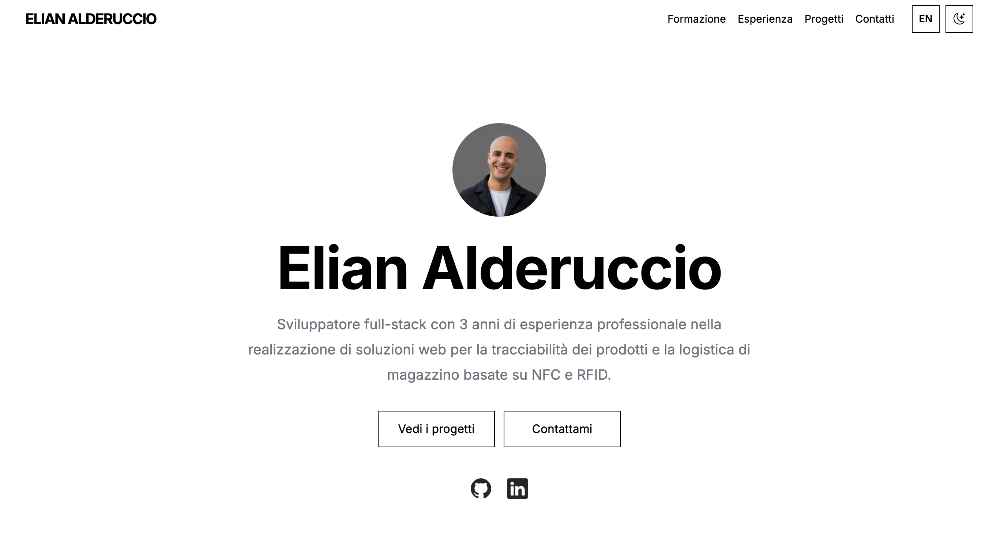

<div align="center">

# 👨‍💻 Personal Portfolio
[](https://elianAlde.github.io)
[](https://elianAlde.github.io/)


Minimalist single-page developer portfolio built with HTML, Bootstrap and JavaScript.
</div>

<p align="center">
  
</p>

## ✨ Features

- Responsive single-page design
- Minimal black & white aesthetic
- **Light / dark mode** with sun/moon toggle (follows the system preference, choice saved in the browser)
- **Bilingual (English / Italian)** with an IT/EN switch, automatic detection of the browser language and saved preference
- Hero section with profile photo, short bio, call-to-action buttons and GitHub / LinkedIn links
- Smooth scrolling navigation
- Scroll reveal animations
- Education & Experience timeline
- Project showcase section
- Contact section with social links
- **Blog** built with Jekyll, with the latest posts shown on the homepage
- Optimized for desktop and mobile


## 📂 Sections

- Home
- Education
- Experience
- Projects
- Blog
- Get In Touch


## 🌍 Translations

All translatable text is marked in `index.html` with a `data-i18n="key"` attribute (English is the default written in the HTML).
Translations live in `script/i18n.js`, one dictionary per language: to change a sentence, edit it there.
The dark mode logic lives in `script/theme.js`.


## 📝 Blog

The blog lives at [`/blog/`](https://elianAlde.github.io/blog/) and is generated by **Jekyll**, which GitHub Pages builds automatically on every push: no server, no build pipeline, no extra dependencies in the repository.

It shares the portfolio's navbar, colors, dark mode and language switch, so it looks like part of the same site.

```
_config.yml           Jekyll settings (Markdown parser, permalinks, default layout)
_includes/nav.html    navbar shared by the homepage and the blog
_includes/post-list.html  list of posts, used on /blog/ and on the homepage
_layouts/default.html base layout for blog pages
_layouts/post.html    layout of a single post (date, language badge, title)
_posts/               the posts, one Markdown file each
blog/index.html       the /blog/ page with all posts
style/blog.css        blog styles and code highlighting (light and dark)
```

### Writing a new post

1. Create a file in `_posts/` named `YYYY-MM-DD-post-title.md`
2. Add the front matter at the top:
   ```yaml
   ---
   title: "Post title"
   description: "One-line summary shown in the post list"
   lang: it   # or en
   ---
   ```
3. Write the post in Markdown, then commit and push: it will be online at `/blog/post-title/` within a few minutes.

Each post is written in a single language, shown with a small IT/EN badge; the language switch translates the interface, not the posts.

### Local preview

```bash
gem install jekyll -v 3.10.0 kramdown-parser-gfm webrick
jekyll serve
```

Then open http://localhost:4000. Jekyll 3.10 is the version used by GitHub Pages; it needs a recent Ruby, since the one bundled with macOS is too old: install it with `brew install ruby` and put `/opt/homebrew/opt/ruby/bin` (plus the gem `bin` folder it prints) at the front of your `PATH`.


<div align="center">

# 📱 NFC Business Card

Included in this repository is a dedicated NFC-powered digital business card located in the `card-nfc` directory.

</div>

<p align="center">
  
</p>

By tapping or scanning an NFC tag, users are instantly redirected to a mobile-optimized page containing:

- Professional contact information
- One-tap contact saving (vCard support for iOS and Android)
- Social media profiles
- GitHub repositories
- Personal portfolio website

The digital card allows visitors to instantly save contact details directly to their smartphone, eliminating the need for manual data entry.

Designed with a mobile-first approach, it provides a fast, seamless, and paperless way to share professional information through NFC technology.